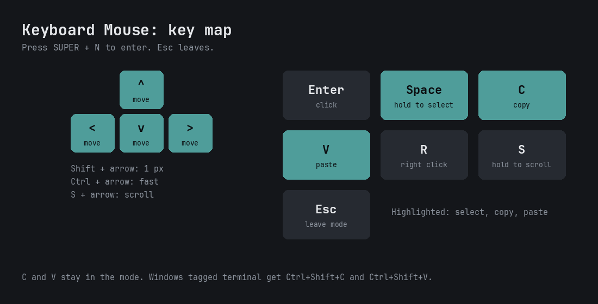
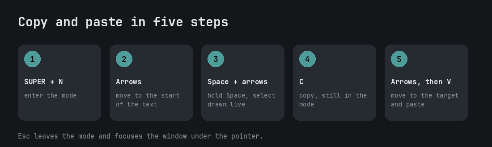

# Keyboard Mouse Controller

Drive the mouse pointer with the arrow keys, so you can click, select, copy, paste and scroll without touching the mouse. It is an Omarchy shell plugin for Hyprland.

Press SUPER + N, move the pointer with the arrows, hold Space to select text, press C to copy and V to paste. Esc leaves.



## Why

Copying and pasting text is the one job that still sends a hand to the mouse. This mode keeps it on the keyboard and uses very few keys, so there is little to memorize.

## Copy and paste



C and V work without leaving the mode. In windows tagged `terminal` they send Ctrl+Shift+C and Ctrl+Shift+V, elsewhere Ctrl+C and Ctrl+V.

## Keys

| Key | Action |
| --- | --- |
| SUPER + N | Enter the mode |
| Arrows | Move the pointer, with a glide while held |
| Shift + arrow | Slow, one pixel per tap |
| Ctrl + arrow | Fast |
| Enter | Left click |
| Space (hold) | Select: the left button is held while Space is held |
| C / V | Copy / paste |
| S (hold) + arrows | Scroll, speeding up the longer you hold. PgUp and PgDn scroll too |
| R | Right click |
| Esc or SUPER + N | Leave, and focus the window under the pointer |

Ctrl or Shift held during Enter or Space reach the app as a Ctrl-click or Shift-click.

## Install

Requires Omarchy with Hyprland 0.55 or newer (the Lua config) and Python 3.

```
git clone https://github.com/G-Pappas/keyboard-mouse-controller ~/.config/omarchy/plugins/gpappas.keymouse
omarchy plugin enable gpappas.keymouse
```

Enabling runs `setup.sh` once. It backs up `~/.config/hypr/bindings.lua` to `bindings.lua.bak.<timestamp>`, appends a short guarded block that loads `keymouse.lua`, and reloads Hyprland. It is safe to run again, and the block does nothing if the plugin is removed.

SUPER + N must be unbound in your config.

## How it works

- `keymouse.lua` is a Hyprland submap named `keymouse`. A 16 ms timer moves the pointer while an arrow is held and polls Space and S.
- Hyprland has no click dispatcher, so `keymouse-daemon` does the clicking. It is a small Python client of the `wlr-virtual-pointer` Wayland protocol. It needs no root, no kernel module and no extra packages.
- Commands reach the daemon through a fifo in `$XDG_RUNTIME_DIR`: `click`, `rclick`, `down`, `up`, `wiggle`, `scroll-up`, `scroll-down`, `scroll-left`, `scroll-right` (each scroll takes an optional `:N` notches) and `quit`. The daemon starts when the mode is entered and runs a single instance.
- While the button is held, the daemon nudges the pointer by one pixel every 30 ms. GTK apps such as Ghostty only redraw a drag selection on a real pointer event, so without this the selection would stay invisible until release.
- Scrolling uses the S key and not a modifier, because apps see held modifiers and Ctrl plus the wheel zooms browsers.

## Files

| File | Purpose |
| --- | --- |
| `manifest.json` | Omarchy plugin manifest, a service plugin |
| `Service.qml` | Runs `setup.sh` on load |
| `setup.sh` | Adds the guarded block to `bindings.lua` |
| `keymouse.lua` | The mode: binds, glide, selection, scroll |
| `keymouse-daemon` | Virtual pointer helper |

## Limits

- Tested on Hyprland 0.56.2 with foot, Ghostty and Chrome.
- Clicks and scrolls are sent to whatever is under the pointer, so check where the pointer is before pressing Enter.
